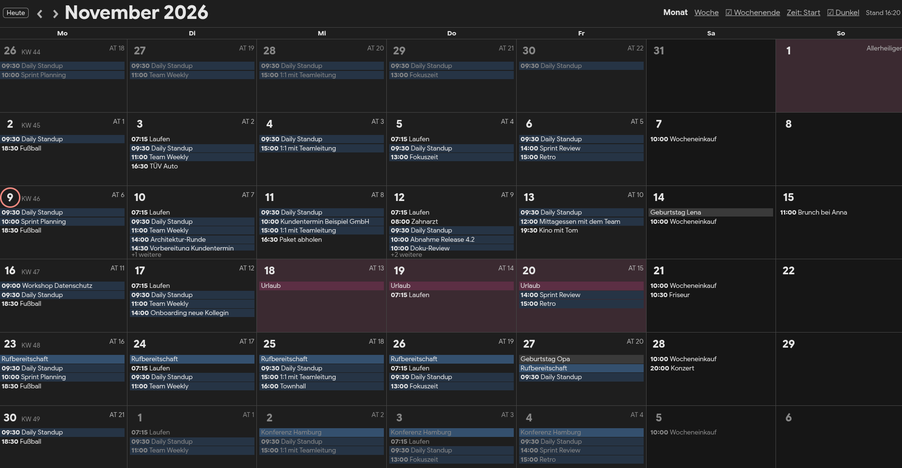
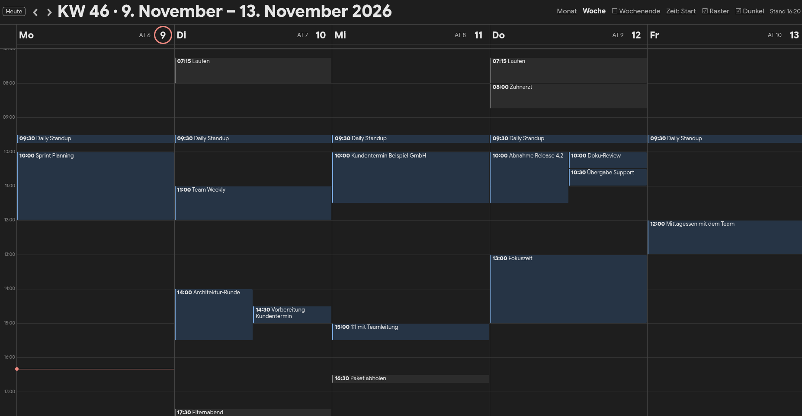
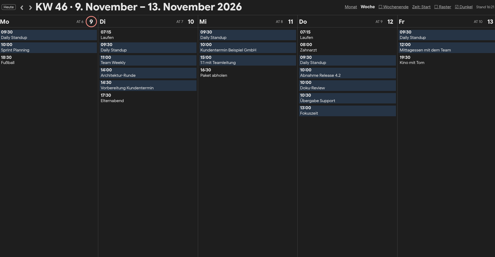
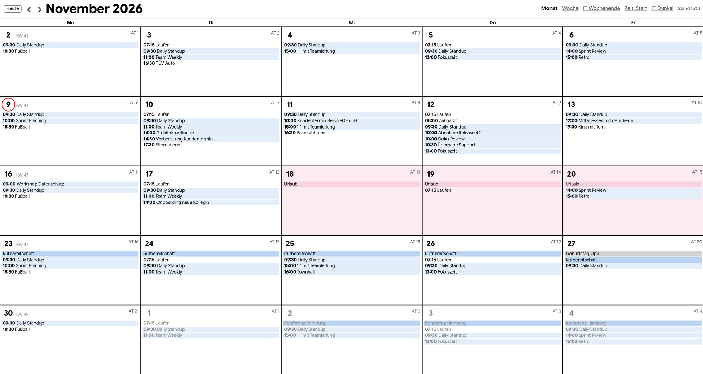
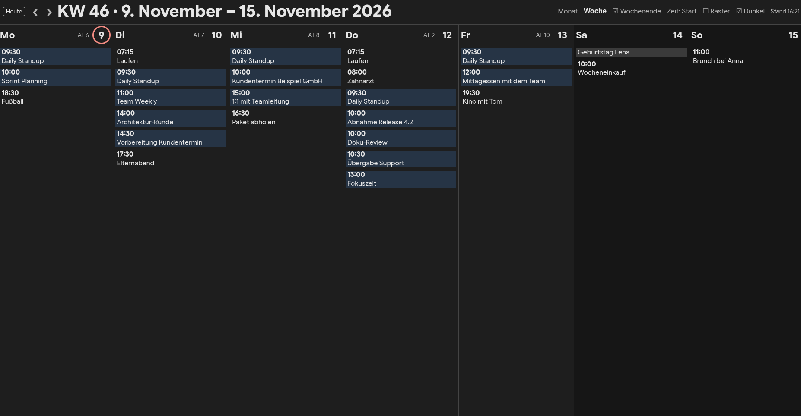
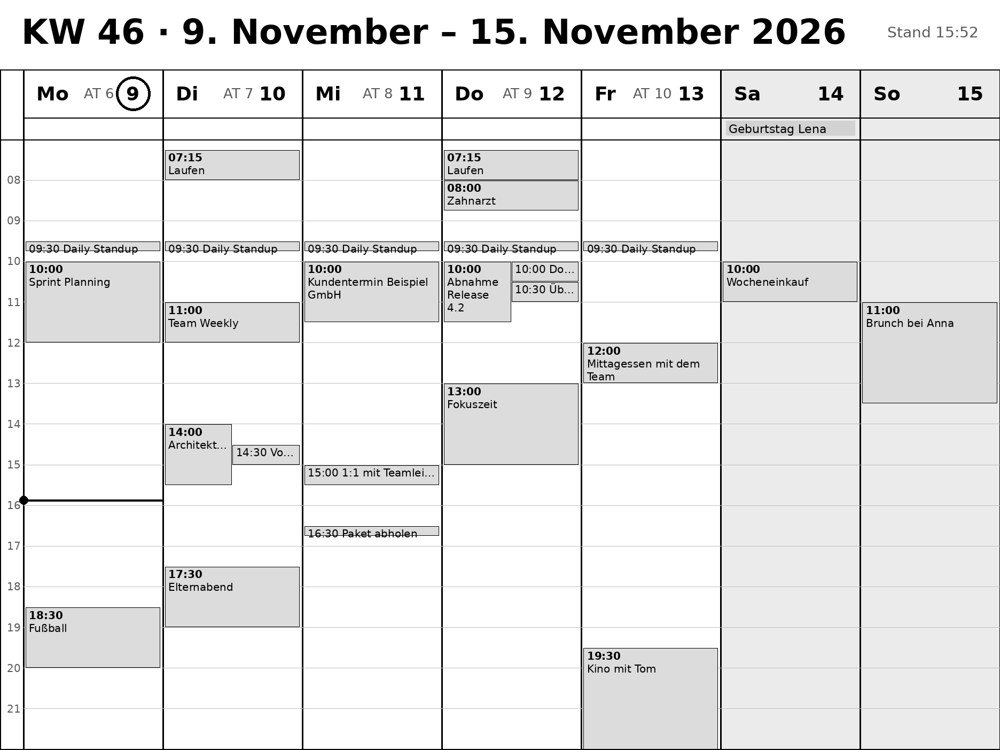

# wallKalender

Self-hosted wall calendar. The server reads ICS calendars (Google, Teams, Nextcloud, …) and shows them
as a web page and as a grayscale PNG (1872×1404) for an e-ink display.

- **Month** and **week** view; the week as an Outlook-style time grid or as a list; weekends can be hidden
- Paging with ‹ › and "Heute" (today), calendar week number in the Monday cell
- **Working days** "AT n" per month; vacation counts as a working day, public holidays (NRW, Germany) don't
- Vacation and holidays highlighted pink, Teams meetings blue, all-day events gray
- Event time as start, start–end, or start with duration
- Dark mode
- Calendars can be hidden and shown again from the "Kalender" menu
- The page reloads by itself when the view changes (e.g. from a Stream Deck) and every 5 minutes

The interface is in German.



| Week as time grid | Week as list |
|---|---|
|  |  |

| Working week only | Week with weekend |
|---|---|
|  |  |

E-ink PNG (`/image.png`, 1872×1404 grayscale):



All screenshots use made-up demo events.

> **The server has no login.** Anyone who can reach it sees all your events. Run it on your home network only,
> never expose it to the internet.

## Getting started

Needs Python 3.11 or newer (tested with 3.11 and 3.14). The PNG needs the DejaVu Sans font (Debian/Ubuntu: `fonts-dejavu-core`).

```sh
python -m venv .venv
.venv/bin/pip install -r requirements.txt
cp .env.example .env          # add your calendar URLs
set -a; . ./.env; set +a
.venv/bin/python server.py    # http://localhost:8080
```

Self-test: `.venv/bin/python test_server.py` prints `ok`.

### Docker

```sh
cp .env.example .env          # add your calendar URLs
cp docker-compose.example.yml docker-compose.yml
docker compose up -d          # http://host:8080 (or PORT from .env)
```

Files for the container go into `./data/` (mounted as `/data`): for example `theme.css` with
`THEME_CSS=/data/theme.css`. To fetch the Teams calendar in a second container, set `TEAMS_MQTT`,
add `file:///data/teams.ics` to `ICS_URLS` and start with `docker compose --profile teams up -d`.

## Control

Everything works by clicking on the page or by calling a URL, e.g. from a Stream Deck: `curl http://host:8080/view/week`.
Settings apply to all browsers at once and are kept in memory only.

| URL | Effect |
|---|---|
| `/` | web page |
| `/image.png` | current view as PNG for the e-ink display |
| `/view/month`, `/view/week` | switch view |
| `/prev`, `/next`, `/today` | one month or week back/forward, back to today |
| `/weekend` | show/hide weekends |
| `/raster` | week as time grid or list |
| `/zeit` | event time: start → start–end → duration |
| `/dark` | dark mode on/off (the PNG stays light) |
| `/termin`, `/termin/2`, … | next (second, …) event with a time as three short lines, e.g. for a Stream Deck key (see below) |
| `/cal/1`, `/cal/2`, … | hide/show a calendar, numbered in `ICS_URLS` order (menu "Kalender" from two calendars on) |

### Next event on a Stream Deck key

`/termin` returns the next event that has a time (running now or within 7 days) as three short lines that fit
a 72 px key, e.g. `09:30` / `Daily` / `Standup`, or `bis 09:45` while it is running. All-day events and hidden
calendars are skipped. `/termin/2`, `/termin/3`, … return the following events, empty if there are none.

With [StreamController](https://github.com/StreamController/StreamController) use the action "Run Command":

- command `curl -sf http://host:8080/termin`
- "Display output" on, "Auto run" e.g. 15 seconds, "Detached" off (otherwise the output is dropped)
- leave the key's own label text empty, it would cover the output

## Settings (`.env`)

| Variable | Meaning |
|---|---|
| `ICS_URLS` | calendar URLs separated by spaces (`https://`, `webcal://`, `file://`), refetched every 5 min |
| `ICS_NAMES` | names for the "Kalender" menu, separated by spaces, same order as `ICS_URLS`; without it the name comes from the calendar file |
| `PORT` | default 8080 |
| `TZ` | default `Europe/Berlin` |
| `DEVICE_REFRESH_URL` | receives a POST on every view change so the display refreshes right away |
| `DARK` | `1` starts in dark mode |
| `THEME_CSS` | path to your own CSS file, added after the built-in styles (see below) |
| `TERMINE` | path to a file with monthly, yearly and single events (see below) |
| `TEAMS_MQTT`, `TEAMS_ICS`, `TEAMS_TOPIC` | only for `teams_ics.py`, see below |

Public holidays are defined at the top of `server.py` (`FEIERTAGE_FEST`, `FEIERTAGE_OSTERN`). For another region,
comment days in or out there.

## Own colors

All colors are CSS variables. Put the ones you want to change into a file and set `THEME_CSS` to its path.
The file is read on every page load, so edits show up after a reload. Light mode is `:root`, dark mode `.dark`:

```css
.dark{--bg:#1e1e2e;--fg:#cdd6f4;--line:#45475a;--we:#181825;--red:#f38ba8;--urlaub:#5e3a4a;--urlaub-edge:#f38ba8}
```

All variables are listed at the top of `CSS` in `server.py`.

## Monthly events

Events that repeat every month or year, or single dates, go into a text file, one rule per line.
Copy `termine.example.txt` to `termine.txt` and set `TERMINE` to its path (Docker: put it into `./data/` and
use `/data/termine.txt`). The file is read again on
every request, so changes show up without a restart.

```
# "4." = every 4th, "4.AT" = 4th working day (Mon–Fri without public holidays, like "AT 4"),
# "-1.AT" = last working day ("-2.AT" second to last, "-1." last day of the month),
# "25.12." = every year, "24.12.2026" or "24.12.26" = once
4.AT 09:00 Reisekosten abrechnen
4. 10:00-10:30 Miete prüfen
1.AT Zeiterfassung
-1.AT 15:00 Monatsabschluss
25.12. #e53935 Weihnachtsfeier
24.12.2026 18:00 Bescherung
```

Without an end time an event lasts 30 minutes, without a time it is all-day. A color like `#e53935` before the
title tints the event on the web page (the e-ink PNG stays gray). If the day doesn't exist in a month
(the 31st in April, the 29th of February), the event is skipped. Lines that don't match are ignored.

With `TERMINE` set, "+ Termin" in the menu opens a form to add a rule and lists the existing ones with ✕ to delete.
The server rewrites the file then, so in Docker `./data` must be writable (no `:ro`).

## Google Calendar

Open calendar.google.com on a computer → ⚙ Settings → under "Settings for my calendars" pick your calendar →
"Integrate calendar" → copy the **Secret address in iCal format** into `ICS_URLS`.
Events from the Samsung Calendar app come along if they are stored in the Google account.

## Teams calendar (optional)

If your Outlook calendar can't be published as ICS, `teams_ics.py` fetches the events through
[teams-for-linux](https://github.com/IsmaelMartinez/teams-for-linux) (MQTT command `get-calendar`, Microsoft Graph)
and writes them to `teams.ics` every 5 minutes. The file only contains titles and times.

1. In the teams-for-linux `config.json`, set `"graphApi": {"enabled": true}` and configure MQTT
   (`commandTopic` `command`). If you changed its `topicPrefix` from `teams`, set the same value as `TEAMS_TOPIC`.
2. Set `TEAMS_MQTT` in `.env` and add `file:///…/teams.ics` to `ICS_URLS`.
3. Keep `set -a; . ./.env; set +a; .venv/bin/python teams_ics.py` running.

The file goes to `teams.ics` in the current directory. Use `-o /path/teams.ics` (or `TEAMS_ICS`) to put it
somewhere else, and point `ICS_URLS` there.

`get-calendar` returns at most 10 events per request
([#3202](https://github.com/IsmaelMartinez/teams-for-linux/issues/3202)), so `teams_ics.py` keeps splitting the
time range until it has everything.

## License

[MIT](LICENSE)
