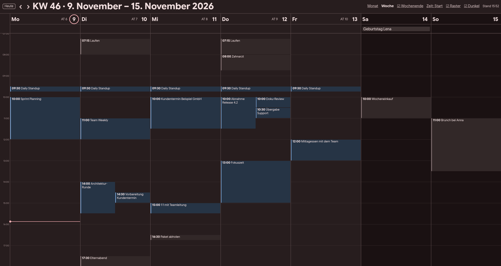

# wallKalender

Self-hosted wall calendar. The server reads ICS calendars (Google, Teams, Nextcloud, …) and shows them
as a web page and as a grayscale PNG (1872×1404) for an e-ink display.

- **Month** and **week** view; the week as an Outlook-style time grid or as a list; weekends can be hidden
- Paging with ‹ › and "Heute" (today), calendar week number in the Monday cell
- **Working days** "AT n" per month; vacation counts as a working day, public holidays (NRW, Germany) don't
- Vacation and holidays highlighted pink, Teams meetings blue, all-day events gray
- Event time as start, start–end, or start with duration
- Dark mode
- The page reloads by itself when the view changes (e.g. from a Stream Deck) and every 5 minutes

The interface is in German.


| Week as time grid, dark mode | Working week only |
|---|---|
|  |  |

E-ink PNG (`/image.png`, 1872×1404 grayscale):


All screenshots use made-up demo events.

> **The server has no login.** Anyone who can reach it sees all your events. Run it on your home network only,
> never expose it to the internet.

## Getting started

Needs Python 3.11 or newer (tested with 3.11 and 3.14). The PNG needs the DejaVu Sans font (Debian/Ubuntu: `fonts-dejavu-core`).

```sh
python -m venv .venv
.venv/bin/pip install -r requirements.txt
cp .env.example .env          # add your calendar URLs
set -a; . ./.env; set +a
.venv/bin/python server.py    # http://localhost:8080
```

Self-test: `.venv/bin/python test_server.py` prints `ok`.

## Control

Everything works by clicking on the page or by calling a URL, e.g. from a Stream Deck: `curl http://host:8080/view/week`.
Settings apply to all browsers at once and are kept in memory only.

| URL | Effect |
|---|---|
| `/` | web page |
| `/image.png` | current view as PNG for the e-ink display |
| `/view/month`, `/view/week` | switch view |
| `/prev`, `/next`, `/today` | one month or week back/forward, back to today |
| `/weekend` | show/hide weekends |
| `/raster` | week as time grid or list |
| `/zeit` | event time: start → start–end → duration |
| `/dark` | dark mode on/off (the PNG stays light) |

## Settings (`.env`)

| Variable | Meaning |
|---|---|
| `ICS_URLS` | calendar URLs separated by spaces (`https://`, `webcal://`, `file://`), refetched every 5 min |
| `PORT` | default 8080 |
| `TZ` | default `Europe/Berlin` |
| `DEVICE_REFRESH_URL` | receives a POST on every view change so the display refreshes right away |
| `TEAMS_MQTT`, `TEAMS_ICS`, `TEAMS_TOPIC` | only for `teams_ics.py`, see below |

Public holidays are defined at the top of `server.py` (`FEIERTAGE_FEST`, `FEIERTAGE_OSTERN`). For another region,
comment days in or out there.

## Google Calendar

Open calendar.google.com on a computer → ⚙ Settings → under "Settings for my calendars" pick your calendar →
"Integrate calendar" → copy the **Secret address in iCal format** into `ICS_URLS`.
Events from the Samsung Calendar app come along if they are stored in the Google account.

## Teams calendar (optional)

If your Outlook calendar can't be published as ICS, `teams_ics.py` fetches the events through
[teams-for-linux](https://github.com/IsmaelMartinez/teams-for-linux) (MQTT command `get-calendar`, Microsoft Graph)
and writes them to `teams.ics` every 5 minutes. The file only contains titles and times.

1. In the teams-for-linux `config.json`, set `"graphApi": {"enabled": true}` and configure MQTT
   (`commandTopic` `command`). If you changed its `topicPrefix` from `teams`, set the same value as `TEAMS_TOPIC`.
2. Set `TEAMS_MQTT` in `.env` and add `file:///…/teams.ics` to `ICS_URLS`.
3. Keep `set -a; . ./.env; set +a; .venv/bin/python teams_ics.py` running.

`get-calendar` returns at most 10 events per request
([#3202](https://github.com/IsmaelMartinez/teams-for-linux/issues/3202)), so `teams_ics.py` keeps splitting the
time range until it has everything.

## License

[MIT](LICENSE)
